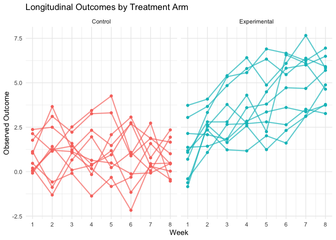
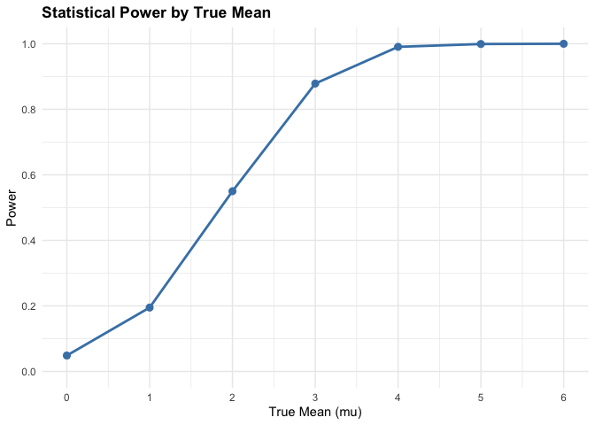
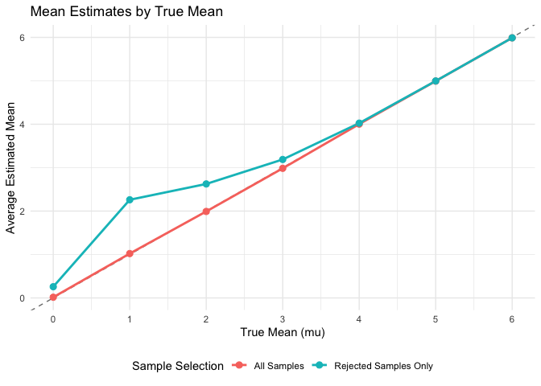

p8105_hw5_qx2277
================
Qiaoen Xia
2026-11-17

\#Q2

``` r
library(tidyverse)
```

    ## ── Attaching core tidyverse packages ──────────────────────── tidyverse 2.0.0 ──
    ## ✔ dplyr     1.2.1     ✔ readr     2.2.0
    ## ✔ forcats   1.0.1     ✔ stringr   1.6.0
    ## ✔ ggplot2   4.0.3     ✔ tibble    3.3.1
    ## ✔ lubridate 1.9.5     ✔ tidyr     1.3.2
    ## ✔ purrr     1.2.2     
    ## ── Conflicts ────────────────────────────────────────── tidyverse_conflicts() ──
    ## ✖ dplyr::filter() masks stats::filter()
    ## ✖ dplyr::lag()    masks stats::lag()
    ## ℹ Use the conflicted package (<http://conflicted.r-lib.org/>) to force all conflicts to become errors

``` r
library(broom)
```

``` r
knitr::opts_chunk$set(
  echo = TRUE,
  warning = FALSE,
  message = FALSE
)

set.seed(8105)
```

``` r
longitudinal_df =
  tibble(
    file_name = list.files("data", pattern = "\\.csv$"),
    file_path = str_c("data/", file_name)
  ) |>
  mutate(
    subject_data = map(file_path, \(path) read_csv(path, show_col_types = FALSE))
  ) |>
  unnest(subject_data) |>
  mutate(
    subject_id = str_remove(file_name, "\\.csv$"),
    arm = case_when(
      str_detect(subject_id, "^con") ~ "Control",
      str_detect(subject_id, "^exp") ~ "Experimental"
    )
  ) |>
  pivot_longer(
    cols = starts_with("week_"),
    names_to = "week",
    values_to = "outcome",
    names_prefix = "week_"
  ) |>
  mutate(
    week = as.numeric(week),
    arm = factor(arm, levels = c("Control", "Experimental"))
  ) |>
  select(subject_id, arm, week, outcome) |>
  arrange(arm, subject_id, week)

longitudinal_df
```

    ## # A tibble: 160 × 4
    ##    subject_id arm      week outcome
    ##    <chr>      <fct>   <dbl>   <dbl>
    ##  1 con_01     Control     1    0.2 
    ##  2 con_01     Control     2   -1.31
    ##  3 con_01     Control     3    0.66
    ##  4 con_01     Control     4    1.96
    ##  5 con_01     Control     5    0.23
    ##  6 con_01     Control     6    1.09
    ##  7 con_01     Control     7    0.05
    ##  8 con_01     Control     8    1.94
    ##  9 con_02     Control     1    1.13
    ## 10 con_02     Control     2   -0.88
    ## # ℹ 150 more rows

``` r
#spaghetti plot
longitudinal_df |>
  ggplot(aes(x = week, y = outcome, group = subject_id)) +
  geom_line(aes(color = arm), alpha = 0.7, linewidth = 0.8) +
  geom_point(aes(color = arm), size = 1.5) +
  facet_wrap(~ arm) +
  scale_x_continuous(breaks = 1:8) +
  labs(
    title = "Longitudinal Outcomes by Treatment Arm",
    x = "Week",
    y = "Observed Outcome",
    color = "Treatment Arm"
  ) +
  theme_minimal() +
  theme(
    legend.position = "none"
  )
```

<!-- -->

The control group shows relatively stable outcomes over the eight weeks,
with individual fluctuations but no clear overall trend. In contrast,
most subjects in the experimental group exhibit increasing outcomes over
time. Although there is variability between subjects in both groups, the
experimental group demonstrates a clear positive trend compared with the
control group.

\#Q3

``` r
# Simulate one dataset and perform a one-sample t-test
sim_t_test = function(mu, n = 30, sigma = 5) {

  sim_data = tibble(
    x = rnorm(n, mean = mu, sd = sigma)
  )

  t.test(sim_data$x, mu = 0) |>
    broom::tidy() |>
    select(estimate, p.value)

}
```

``` r
# Run 5000 simulations for each true mean
sim_results =
  expand_grid(
    mu = 0:6,
    iter = 1:5000
  ) |>
  mutate(
    test_results = map(mu, sim_t_test)
  ) |>
  unnest(test_results) |>
  mutate(
    reject_null = p.value < 0.05
  )

sim_results
```

    ## # A tibble: 35,000 × 5
    ##       mu  iter estimate p.value reject_null
    ##    <int> <int>    <dbl>   <dbl> <lgl>      
    ##  1     0     1   1.43     0.121 FALSE      
    ##  2     0     2   0.328    0.756 FALSE      
    ##  3     0     3   0.427    0.610 FALSE      
    ##  4     0     4  -0.261    0.797 FALSE      
    ##  5     0     5   0.437    0.667 FALSE      
    ##  6     0     6   0.0525   0.947 FALSE      
    ##  7     0     7  -0.631    0.476 FALSE      
    ##  8     0     8  -0.630    0.443 FALSE      
    ##  9     0     9   0.864    0.149 FALSE      
    ## 10     0    10  -0.436    0.660 FALSE      
    ## # ℹ 34,990 more rows

``` r
power_results =
  sim_results |>
  group_by(mu) |>
  summarize(
    power = mean(reject_null),
    .groups = "drop"
  )

power_results
```

    ## # A tibble: 7 × 2
    ##      mu  power
    ##   <int>  <dbl>
    ## 1     0 0.0486
    ## 2     1 0.195 
    ## 3     2 0.55  
    ## 4     3 0.879 
    ## 5     4 0.991 
    ## 6     5 0.999 
    ## 7     6 1

``` r
power_results |>
  ggplot(aes(x = mu, y = power)) +
  geom_line(color = "steelblue", linewidth = 1) +
  geom_point(color = "steelblue", size = 2.5) +
  scale_x_continuous(breaks = 0:6) +
  scale_y_continuous(
    limits = c(0, 1),
    breaks = seq(0, 1, 0.2)
  ) +
  labs(
    title = "Statistical Power by True Mean",
    x = "True Mean (mu)",
    y = "Power"
  ) +
  theme_minimal() +
  theme(
    plot.title = element_text(face = "bold")
  )
```

<!-- -->

Statistical power increases as the true mean moves farther away from the
null value of zero. When μ = 0, the rejection proportion is
approximately 0.05, consistent with the significance level. Power
increases from 0.195 at μ = 1 to 0.879 at μ = 3, and approaches 1 when μ
≥ 4. With sample size and standard deviation held constant, larger
effect sizes are more likely to be detected.

``` r
estimate_results =
  sim_results |>
  group_by(mu) |>
  summarize(
    overall_mean = mean(estimate),
    rejected_mean = mean(estimate[reject_null]),
    .groups = "drop"
  )

estimate_results
```

    ## # A tibble: 7 × 3
    ##      mu overall_mean rejected_mean
    ##   <int>        <dbl>         <dbl>
    ## 1     0       0.0157         0.258
    ## 2     1       1.02           2.26 
    ## 3     2       1.99           2.62 
    ## 4     3       2.98           3.19 
    ## 5     4       4.00           4.02 
    ## 6     5       4.99           5.00 
    ## 7     6       5.99           5.99

``` r
estimate_results |>
  pivot_longer(
    cols = c(overall_mean, rejected_mean),
    names_to = "estimate_type",
    values_to = "mean_estimate"
  ) |>
  mutate(
    estimate_type = recode(
      estimate_type,
      overall_mean = "All Samples",
      rejected_mean = "Rejected Samples Only"
    )
  ) |>
  ggplot(aes(x = mu, y = mean_estimate, color = estimate_type)) +
  geom_abline(
    slope = 1,
    intercept = 0,
    linetype = "dashed",
    color = "gray50"
  ) +
  geom_line(linewidth = 1) +
  geom_point(size = 2.5) +
  scale_x_continuous(breaks = 0:6) +
  labs(
    title = "Mean Estimates by True Mean",
    x = "True Mean (mu)",
    y = "Average Estimated Mean",
    color = "Sample Selection"
  ) +
  theme_minimal() +
  theme(
    legend.position = "bottom"
  )
```

<!-- -->

The average estimates across all samples closely follow the true means,
consistent with the unbiasedness of the sample mean. However, when only
samples that reject the null hypothesis are considered, the average
estimates tend to exceed the true means, particularly when the effect
size is small and power is low. This occurs because statistically
significant results are more likely to arise from samples with estimates
farther from zero, introducing selection bias. As power approaches one,
nearly all samples reject the null hypothesis, and the conditional
average becomes closer to the true mean. At μ = 0, the conditional
average is theoretically zero due to the symmetry of the two-sided test,
although some random variation is observed in the simulation.
